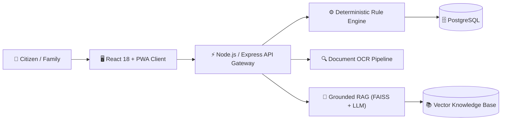

<div align="center">

# 🏛️ Sarthi (सारथी)
### **AI-Powered Government Scheme Assistance Platform**

*Bridging the gap between 3,000+ Indian Welfare Schemes and the Citizens who need them.*

[](https://opensource.org/licenses/MIT)
[](https://react.dev/)
[](https://tailwindcss.com/)
[](https://nodejs.org/)
[](https://github.com/facebookresearch/faiss)
[](https://www.meity.gov.in/data-protection-framework)

</div>

---

## 📌 Overview

India runs over **3,000+ central and state schemes**, yet millions miss out due to complex bureaucratic language, fragmented information, and unguided document requirements. Existing portals stop at binary *"Not Eligible"* dead-ends.

> **Sarthi's Mission**: Tell citizens which schemes they qualify for, explain **why**, identify missing criteria, and provide an exact **local resolution path** (which office, fee, turnaround time) to bridge the gap—in their language, for their entire household.

---

## ⚡ Core Pillars

* ⚖️ **Rules Decide, AI Explains**: Eligibility is computed solely by an auditable, deterministic Boolean rule engine. AI models never decide eligibility; they retrieve and explain verified scheme rules in regional languages.
* 📄 **Document Verification & Gap Scoring** *(Patent Candidate)*: Automated OCR (Tesseract / Cloud Vision) extracts data from citizen documents, calculates a partial-eligibility confidence score, and flags exact missing proofs.
* 📍 **Localized Resolution Paths**: Shows exact district-level offices (Tehsil/CSC), application fees, and turnaround times for obtaining missing certificates.
* 🤖 **Grounded RAG Assistant**: Multi-lingual conversational agent powered by vector search (FAISS/Chroma) with strict anti-hallucination guardrails and mandatory official citations.
* 👨‍👩‍👧 **Multi-Generational Family Dashboard**: One account manages and tracks benefits for elderly parents, spouse, and children.
* 🔒 **DPDP Act Compliant**: Ephemeral document processing, masked Aadhaar storage (only last 4 digits), and zero commercial tracking.

---

## 🏛️ Architecture



---

## 🛠️ Tech Stack

| Domain | Technologies |
|:---|:---|
| **Frontend** | React 18, TypeScript, Vite, Tailwind CSS, Lucide Icons, PWA (IndexedDB) |
| **Backend** | Node.js (v20+ LTS), Express.js, TypeScript, Prisma ORM, JWT Authentication |
| **Data & Vector** | PostgreSQL 15+ (Full-Text Search), FAISS / ChromaDB |
| **AI / OCR** | LangChain / LlamaIndex, Tesseract OCR, OpenCV Image Preprocessing |

---

## 🚀 Quick Start (Local Setup)

### 1. Clone & Install Frontend
```bash
# Clone the repository
git clone https://github.com/ABHINAVJINDAL26/Sarthi_goverment_scheme.git
cd Sarthi_goverment_scheme

# Install dependencies & run Vite dev server
npm install
npm run dev
```
> The web client will run at **`http://localhost:3000`** (or `http://localhost:5173`).

### 2. Backend Setup *(Node.js & Express)*
```bash
cd backend

# Install dependencies
npm install

# Start development server
npm run dev
```
> API server will run at **`http://localhost:5000`** (or `http://localhost:8000`).

---

## 📂 Project Structure

```text
├── public/       # Static assets and brand icons
├── src/          # Frontend application code
├── PRD.md        # Product Requirements Document
├── README.md     # Project documentation
└── package.json  # Dependencies & build scripts
```

<details>
<summary><b>📖 View Full Specifications & Detailed Feature Matrix (F1 to F17)</b></summary>

For in-depth functional workflows, edge cases, and technical blueprints, refer to:
* 📄 **[PRD.md](PRD.md)**: Product journeys, user stories, and acceptance criteria.
* 📑 **[Sarthi_Feature_Specification.pdf](Sarthi_Feature_Specification.pdf)**: Complete 25-page engineering specification covering all 17 feature modules (F1 Onboarding through F17 Feedback).
</details>

---

## ⚖️ Disclaimer

*Sarthi is an independent citizen-assistance platform developed for capstone research. It provides preliminary screening based on publicly available notifications (`myscheme.gov.in`). Final benefit approval remains the sole prerogative of the respective government authorities.*

---

<div align="center">
Made with ❤️ for Citizen Welfare & Digital Empowerment in India.
</div>
